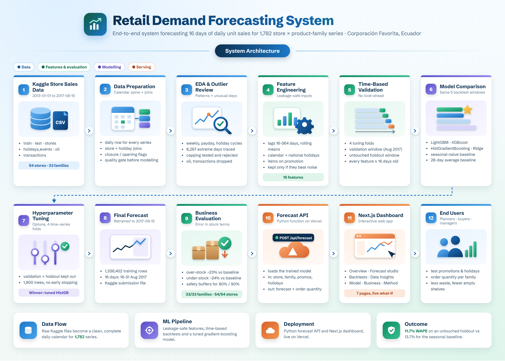
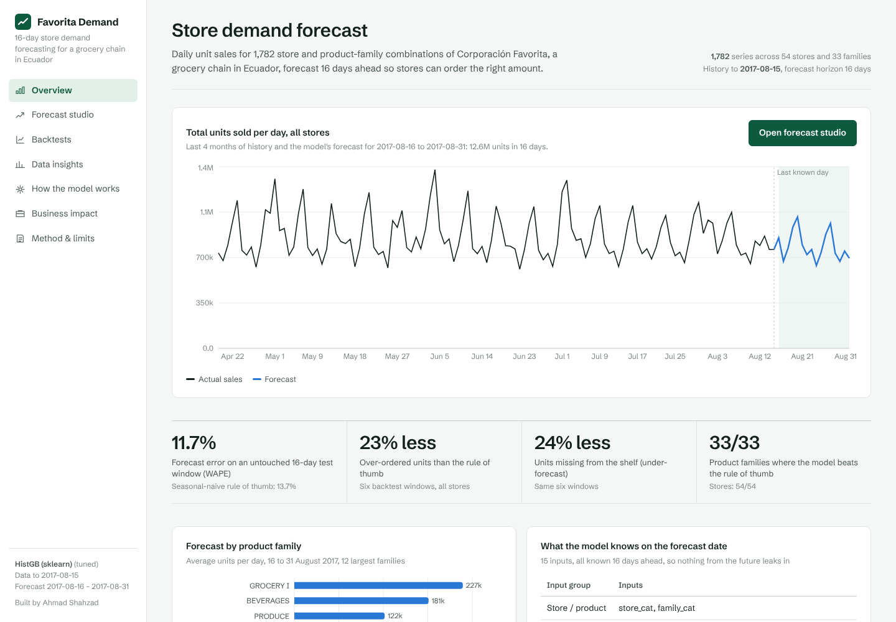
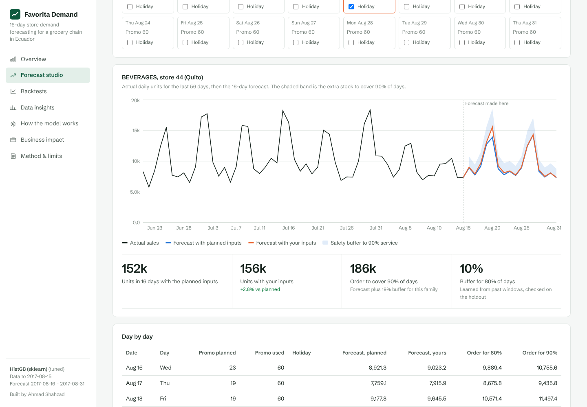
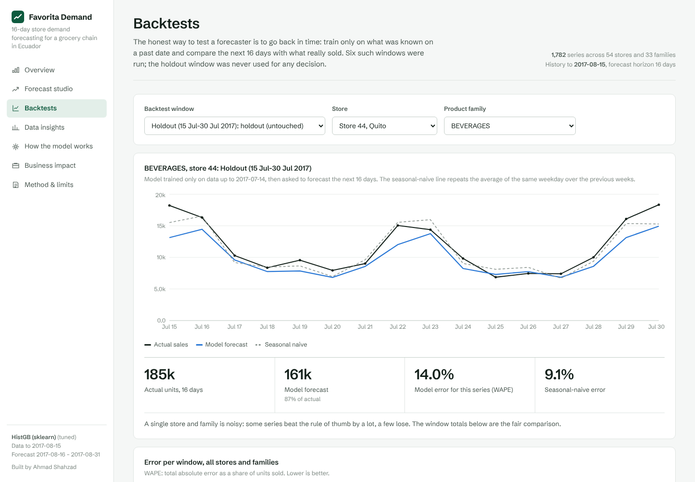
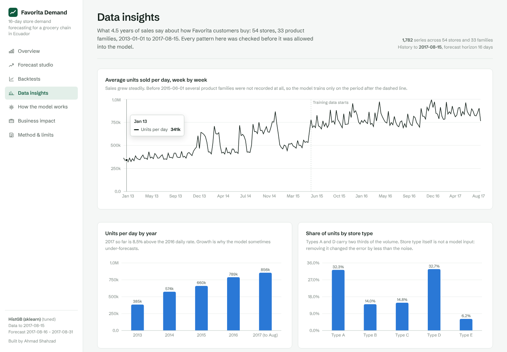
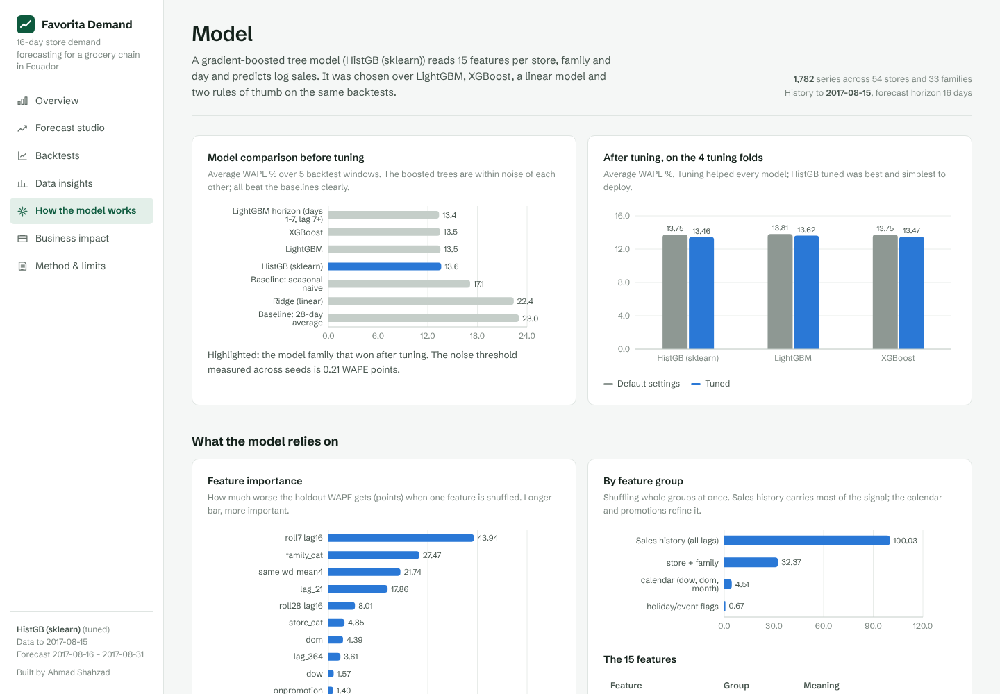
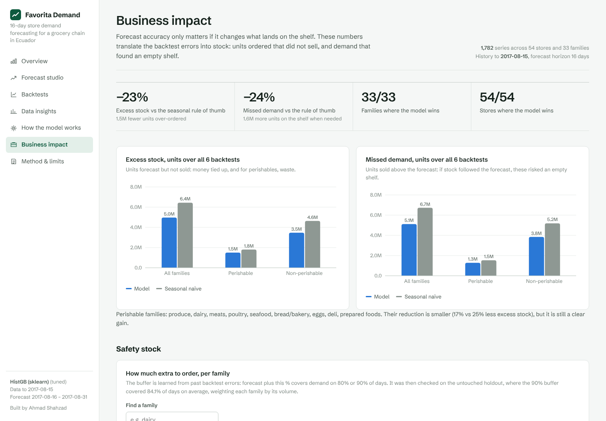

<h1 align="center">Retail Demand Forecasting System</h1>

<p align="center">
  Forecasting 16 days of daily unit sales for <b>1,782 store × product-family series</b> of Corporación Favorita, a grocery chain in Ecuador —<br>
  built end-to-end as a leakage-safe time-series pipeline and deployed as a live forecasting dashboard.
</p>

<p align="center">
  <a href="https://favorita-demand-forecast.vercel.app" target="_blank">
    
  </a>
</p>

---

## Overview

The **Retail Demand Forecasting System** turns 4.5 years of raw daily sales (2013-01-01 to 2017-08-15) from the Kaggle *Store Sales – Time Series Forecasting* competition into a forecast that a store planner can actually use. For every one of 54 stores and 33 product families it predicts how many units will sell on each of the next 16 days, and how much extra stock is needed to cover 80% or 90% of days.

The project is a complete system rather than a notebook exercise. Ten reproducible Python stages handle data preparation, exploratory analysis, outlier review, feature testing, model comparison, tuning, the final forecast and a business evaluation. A Next.js dashboard with a live Python forecast API then lets anyone change the promotion plan or mark a holiday and see the forecast recalculated by the trained model.

Every decision was tested on the data before it was kept. Outlier treatments, candidate features and model settings were accepted only when they beat the seed-to-seed noise of the model (0.21 WAPE points), and one 16-day holdout window was kept completely untouched for the final, honest estimate.

| Metric | Model | Seasonal-naive baseline |
|---|---|---|
| WAPE on the untouched holdout (15–30 Jul 2017) | **11.73%** | 13.73% |
| WAPE on the validation window (Aug 2017) | **11.45%** | 18.31% |
| Over-ordered units, 6 backtest windows | **−23%** vs baseline | — |
| Units missing from the shelf, 6 backtest windows | **−24%** vs baseline | — |
| Product families / stores where the model wins | **33 / 33** and **54 / 54** | — |

*WAPE = total absolute error ÷ total units sold. The seasonal-naive baseline repeats the recent average of the same weekday.*

## Aim

The aim of this project is to build a **trustworthy daily demand forecast that supports ordering decisions** and that:

- uses only information genuinely available on the forecast date: every sales feature is at least 16 days old, so no day of the forecast ever sees a sale it could not know;
- is evaluated honestly with time-based backtests and a holdout window that was never used for any choice, against a strong seasonal-naive baseline rather than a weak one;
- translates forecast error into business terms: excess stock, missed demand and the safety stock each product family needs;
- is usable by non-technical people through a live dashboard where they can test promotion and holiday scenarios.

## Features

- **Ten-stage reproducible pipeline** — `src/01` to `src/10`, run in order from the project root; every stage writes its evidence to `reports/`.
- **Data preparation with a quality gate** — a complete daily calendar for all 1,782 series, store and holiday joins, store-closure and store-opening flags, and a training start of 2015-06-01 because several families were not recorded before that date.
- **Outlier review, not blind capping** — 8,267 extreme store-family-days were traced to causes (company-wide special days, promotion surges, stock-outs, bulk orders). Capping and replacing were tested on four windows and rejected; no rows were changed.
- **Leakage-safe feature engineering** — 15 features: store, family, calendar (day of week, day of month, month), national holiday / event / earthquake flags, items on promotion, and sales-history features from 16 to 364 days back. Each candidate was added or removed one at a time and kept only if it beat the noise.
- **Model comparison and tuning** — LightGBM, XGBoost, HistGradientBoosting and Ridge against two baselines on five backtest windows, then Optuna tuning on four time-series folds. A tuned `HistGradientBoostingRegressor` (scikit-learn) was chosen: best after tuning and the simplest to deploy.
- **Business evaluation** — error by family, store, store type, forecast day and day type; over-stock and under-stock in units; permutation feature importance; per-family safety buffers learned on past windows and checked on the holdout.
- **Live forecast API** — a Python serverless function (`dashboard/api/forecast.py`) that loads the trained model and returns the baseline forecast, the scenario forecast and order quantities for 80% / 90% coverage. Its output is verified to match the Phase 08 forecast exactly.
- **Interactive dashboard** — seven pages: Overview, Forecast studio (what-if), Backtests, Data insights, How the model works, Business impact, and Method & limits.

## Architecture Diagram

<p align="center">
  
</p>

<p align="center">
  <i>End-to-end flow: raw Kaggle files → data preparation, EDA and outlier review → leakage-safe features → model comparison, tuning and final forecast → business evaluation → export → Python forecast API and Next.js dashboard on Vercel.</i>
</p>

## Application Screenshots

### Overview


### Forecast Studio (live what-if forecast)


### Backtests


### Data Insights


### How the Model Works


### Business Impact


## Validation Design

| Window | Trained on data up to | Forecast period | Used for |
|---|---|---|---|
| Jun 2017, Aug 2016, Dec 2016, May 2016 | The day before each window starts | 16 days each | Tuning folds |
| Validation | 2017-07-30 | 31 Jul – 15 Aug 2017 | Choosing between models |
| Holdout | 2017-07-14 | 15 – 30 Jul 2017 | Reported only, never used for a decision |
| Final forecast | 2017-08-15 | 16 – 31 Aug 2017 | Kaggle submission and dashboard |

For each window the model is retrained only on data before its cutoff, and the features are rebuilt from that point.

## Project Structure

```
store-sales-time-series-forecasting/
├── data/
│   ├── raw/                 # Kaggle files (train, test, stores, holidays_events, oil, transactions)
│   └── processed/           # cleaned master table and feature table
├── models/                  # trained final model
├── reports/                 # evidence from every phase (CSV / JSON)
├── submissions/             # Kaggle submission file
├── src/
│   ├── 01_data_preparation.py
│   ├── 01b_phase1_decision_tests.py
│   ├── 02_pre_eda.py
│   ├── 03_outliers_detection_and_treatment.py
│   ├── 04_Post_EDA.py
│   ├── 05_Feature_Eng.py
│   ├── 06_model_comparison.py
│   ├── 07_tuning.py
│   ├── 08_final_forecast.py
│   ├── 09_business_evaluation.py
│   └── 10_export_dashboard.py
└── dashboard/
    ├── api/forecast.py      # live forecast function (Python, Vercel)
    ├── app/                 # Next.js pages
    ├── components/          # charts, forecast studio, tables
    └── public/data/         # exported results the dashboard reads
```

## Run It Locally

```powershell
# 1) Pipeline (from the project root, in order)
python src\01_data_preparation.py
# ... through ...
python src\09_business_evaluation.py
python src\10_export_dashboard.py     # writes dashboard data, API assets and requirements.txt

# 2) Dashboard
cd dashboard
npm install
python api\dev_server.py              # terminal 1: forecast API on port 8000
npm run dev                           # terminal 2: website on http://localhost:3000
```

## Tech Stack

- **Data and modelling:** Python, pandas, NumPy, scikit-learn (`HistGradientBoostingRegressor`), LightGBM, XGBoost, Optuna
- **Dashboard:** Next.js, React, Recharts
- **Deployment:** Vercel (static pages and a Python serverless function)

## Benefits

- **Better ordering decisions** — compared with the seasonal rule of thumb, the model cut over-ordered units by 23% and units missing from the shelf by 24% across six backtest windows.
- **Ready-to-use order quantities** — per-family safety buffers turn a single forecast into an order that covers 80% or 90% of days, learned from past errors and checked on unseen data.
- **Trustworthy results** — time-based backtests, a 16-day lag rule and an untouched holdout mean the reported error reflects what the model can do on future days.
- **Scenario planning** — planners can change the promotion plan or mark a holiday for any store and family and see the effect immediately.
- **Transparent limits** — the dashboard reports where the model is weaker (local holidays, very small series, periods of fast growth) instead of hiding them.
- **Reusable foundation** — the cleaned calendar, outlier review and leakage-safe feature code can support further retail analytics such as inventory optimisation.

## Conclusion

The Retail Demand Forecasting System shows a complete, evidence-driven approach to applied time-series machine learning in retail. Instead of reporting whatever score a model happens to reach, it builds a clean daily calendar, traces unusual days to their causes, keeps only the features and settings that beat measured noise, and judges the result on a window that was never used for any decision. The result — **11.73% WAPE on the untouched holdout against 13.73% for the seasonal baseline**, better accuracy in all 33 product families and all 54 stores, and a live what-if dashboard — is a defensible, deployment-ready demand forecast.

<p align="center">
  <a href="https://favorita-demand-forecast.vercel.app" target="_blank">
    
  </a>
</p>

<p align="center"><sub>Built by  · Data: Kaggle, Store Sales – Time Series Forecasting (Corporación Favorita)</sub></p>
