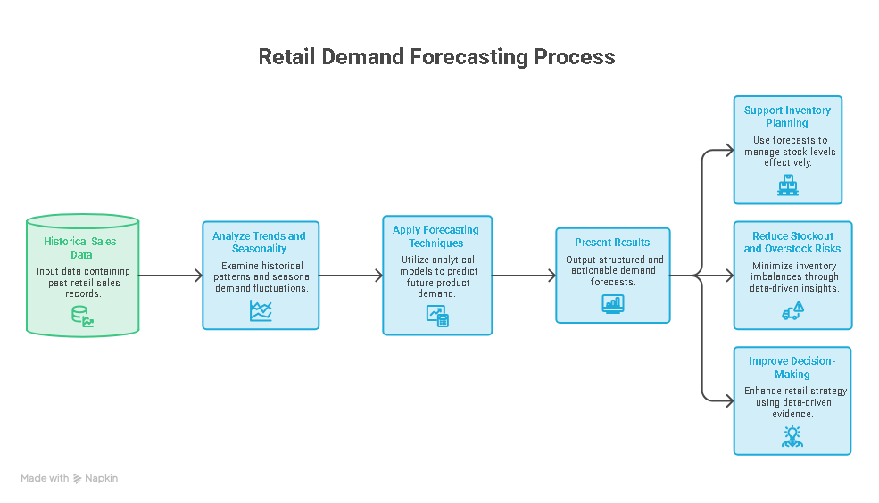

# Retail Demand Forecasting

## Overview

**Retail Demand Forecasting** is a demand forecasting and analytics system designed to help retail businesses understand historical sales patterns and predict future product demand.

The system processes historical retail sales data, analyzes demand trends and seasonality, applies forecasting techniques, and presents the results in a structured and actionable format.

The main purpose of the project is to support better inventory planning, reduce stockout and overstock risks, and improve data-driven retail decision-making.

---

## Aim

- Forecast future retail product demand
- Analyze historical sales patterns and trends
- Identify seasonal demand behavior
- Support inventory planning and replenishment decisions
- Reduce the risk of stockouts and overstock
- Provide data-driven insights for retail operations

---

## Key Features

- **Sales Data Processing** — Processes historical retail sales data for forecasting
- **Demand Analysis** — Analyzes historical demand patterns and trends
- **Demand Forecasting** — Predicts future product demand using forecasting models
- **Seasonality Analysis** — Identifies recurring demand patterns and seasonal behavior
- **Inventory Support** — Helps identify potential demand-related inventory risks
- **Performance Evaluation** — Evaluates forecasting performance using appropriate metrics
- **Visualization** — Presents demand trends and forecasting results through visual analytics

---

## Benefits

- **Better Inventory Planning** — Helps businesses plan inventory according to expected demand
- **Reduced Stockout Risk** — Identifies periods where demand may increase
- **Reduced Overstock** — Helps avoid unnecessary inventory accumulation
- **Improved Decision Making** — Provides data-driven demand insights
- **Faster Analysis** — Automates repetitive demand analysis
- **Improved Forecasting** — Uses historical patterns to support future demand planning

---

## Workflow

The system follows this overall process:

**Retail Sales Data → Data Processing → Exploratory Data Analysis → Feature Engineering → Forecasting Model → Model Evaluation → Demand Forecast → Business Insights**

### Workflow Steps

**1. Data Collection**  
Historical retail sales data is provided as input to the system.

**2. Data Processing**  
The sales data is cleaned, transformed, and prepared for analysis.

**3. Exploratory Data Analysis**  
Historical demand is analyzed to identify trends, seasonality, variations, and important demand patterns.

**4. Feature Engineering**  
Relevant time-based and demand-related features are prepared for the forecasting model.

**5. Demand Forecasting**  
Forecasting models use historical demand patterns and engineered features to predict future sales.

**6. Model Evaluation**  
Forecast results are evaluated against actual demand using forecasting performance metrics.

**7. Demand Forecast Generation**  
The selected forecasting approach produces future demand estimates.

**8. Business Insights**  
Forecast results are used to support inventory planning, replenishment decisions, and retail demand management.

---

## Use Cases

- Retail demand forecasting
- Inventory planning
- Replenishment planning
- Stockout risk analysis
- Overstock reduction
- Sales trend analysis
- Seasonal demand analysis
- Retail business decision support

---

## Project Goal

The goal of **Retail Demand Forecasting** is to transform historical retail sales data into reliable future demand insights that can help businesses make better inventory and operational decisions.

> **Sales Data → Analyze → Forecast → Evaluate → Predict Demand → Support Decisions**